### 1. Estado deseado de la infraestructura

Tras ejecutar `terraform apply`, se desplegó correctamente la infraestructura de BETESP en Microsoft Azure utilizando Terraform.

La infraestructura incluye:

- Grupo de recursos `rg-betesp-infra`.
- Red virtual con subredes independientes para Container Apps y PostgreSQL.
- Grupo de seguridad de red para proteger el acceso a PostgreSQL.
- Máquina virtual Linux con PostgreSQL 17.
- Entorno de Azure Container Apps.
- Cinco aplicaciones correspondientes a los microservicios de BETESP.

El estado de Terraform se almacena en un backend remoto de Azure Storage, permitiendo mantener el estado centralizado y utilizar bloqueo durante las operaciones.

**Evidencias:**

1. Resultado de `terraform apply`, mostrando la creación y actualización de recursos.
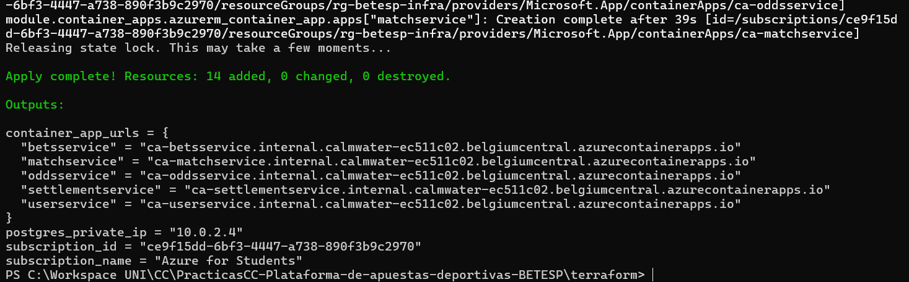
2. Resultado de `terraform state list`, mostrando los recursos gestionados por Terraform.
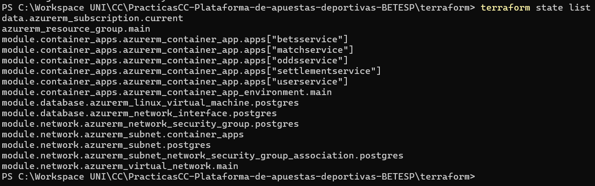
3. Captura de Azure Portal mostrando los recursos desplegados en `rg-betesp-infra`.
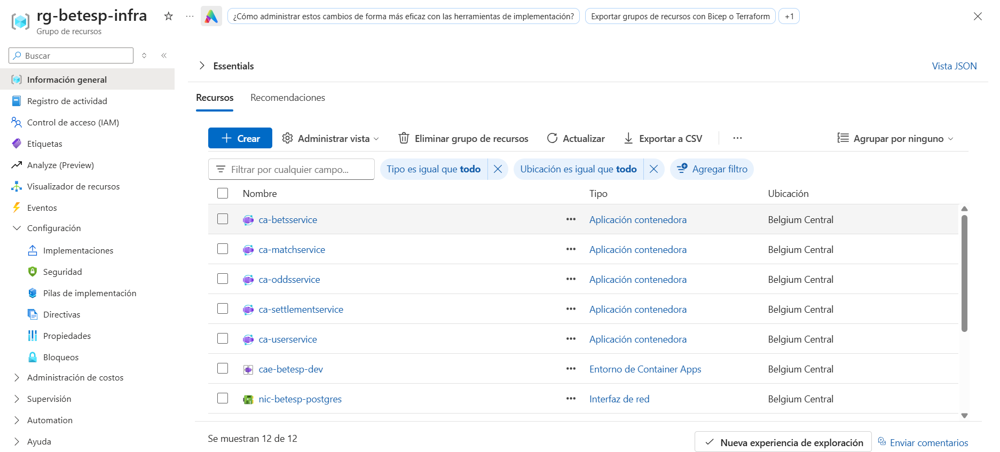
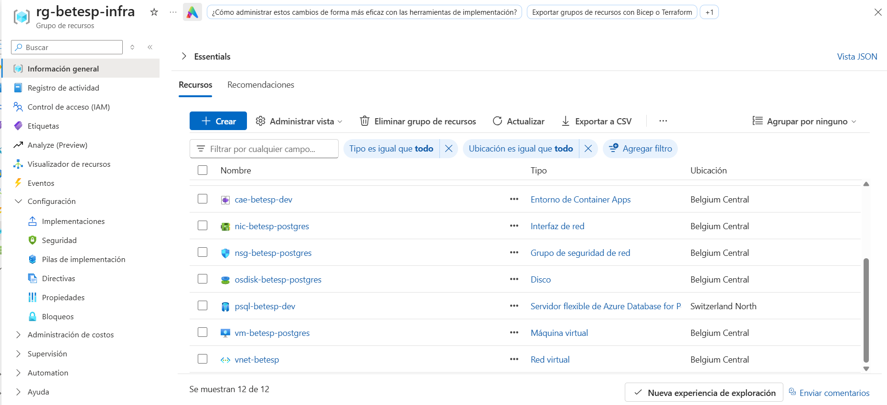
4. Resultado de `terraform plan`, mostrando `No changes. Your infrastructure matches the configuration.`
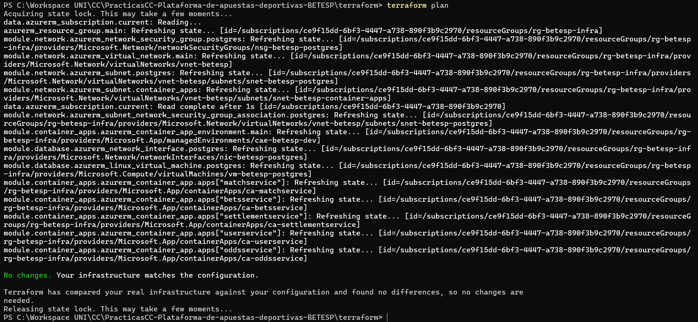

Estas evidencias demuestran que la infraestructura desplegada coincide con el estado deseado definido mediante código Terraform.

### 2. Inducción de Drift

Para simular una desviación (*configuration drift*), se modificó manualmente desde Azure Portal la etiqueta `environment` del grupo de recursos `rg-betesp-infra`.

El valor original, definido en Terraform, era `development`. Se modificó manualmente a `drift-test`, sin realizar ningún cambio en el código de infraestructura.

**Evidencia:**

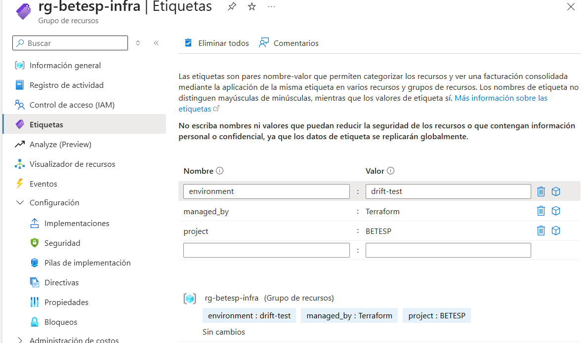

### 3. Fase de Observación

Después de introducir la modificación manual, se ejecutó el comando `terraform plan` para comparar la configuración declarada con el estado real de los recursos en Azure.

Terraform detectó la discrepancia en la etiqueta `environment` y propuso restaurar su valor original de `drift-test` a `development`.

Esto demuestra la capacidad de Terraform para detectar desviaciones respecto al estado deseado.

**Evidencia:**

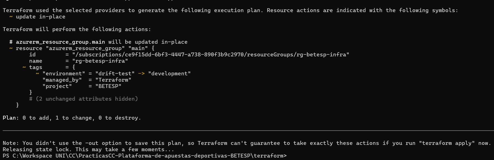

### 4. Fase de Reconciliación

Una vez identificada la desviación, se ejecutó `terraform apply` para aplicar la configuración declarada en el código.

Terraform actualizó el grupo de recursos en Azure y restauró la etiqueta `environment` a su valor original: `development`.

De esta forma, la infraestructura real volvió a coincidir con el estado deseado.

**Evidencia:**

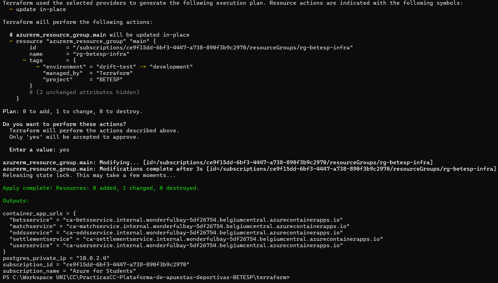

### 5. Verificación de la Reconciliación

Finalmente, se ejecutó de nuevo `terraform plan` para comprobar que la infraestructura estaba sincronizada con la configuración declarada.

El resultado fue `No changes. Your infrastructure matches the configuration.`, confirmando que Terraform había reconciliado correctamente la desviación. También se comprobó mediante el portal de Azure.

**Evidencia:**

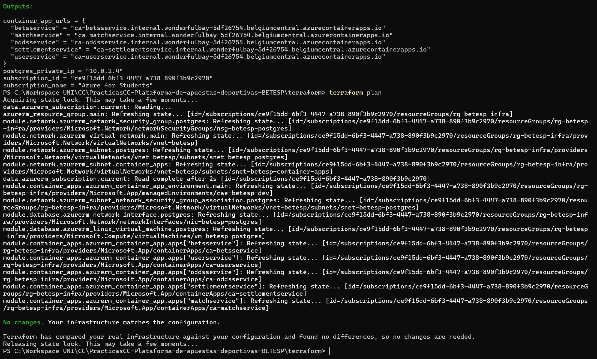
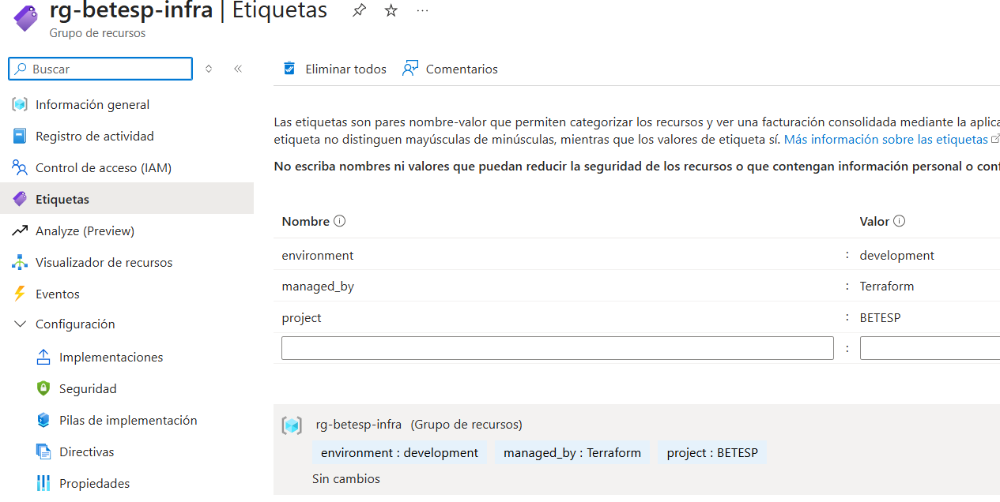

### 6. Verificación de Apagado (Teardown Verification)

Para comprobar que la infraestructura puede eliminarse correctamente y evitar que permanezca desplegada fuera de las horas de laboratorio, se ejecutó el comando `terraform destroy`.

Antes de la eliminación se revisó el plan de destrucción con `terraform plan -destroy`.

Tras confirmar la operación, Terraform eliminó correctamente los recursos de infraestructura desplegados en Azure, incluyendo la red virtual, las subredes, las reglas de seguridad, la máquina virtual PostgreSQL y las aplicaciones de Azure Container Apps.

El backend remoto de Terraform, almacenado en el grupo de recursos independiente `rg-betesp-tfstate`, se conservó para mantener el almacenamiento del estado y permitir futuras ejecuciones de Terraform.

**Evidencia 1. Ejecución de terraform destroy:**

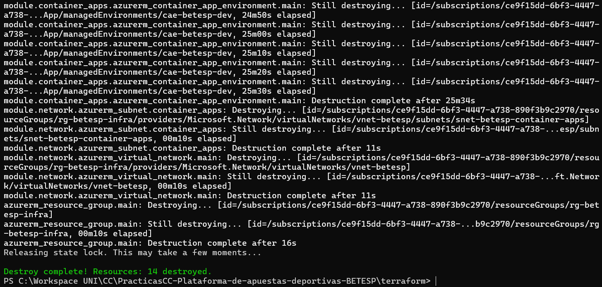

**Evidencia 2. Verificación de recursos eliminados:**

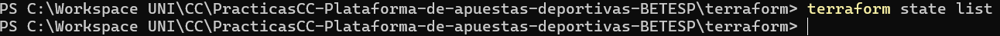

El resultado confirma que los recursos administrados por Terraform fueron eliminados y que no queda infraestructura activa de BETESP en el grupo de recursos de despliegue.